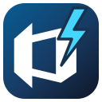

<p align="center">
  
</p>

# ADO Boost

ADO Boost is an Edge-first browser extension that makes Azure DevOps pull request reviews easier to navigate, discuss, and submit.

> [!NOTE] 
> ADO Boost is not yet available on the Edge Add-Ons Store or Chrome Web Store. See below on how to install it as an unpacked extension.

## What it adds

- Overall PR and per-file added/removed line diff counts follow the user's whitespace setting supplied by ADO on PR and PR-list pages. Counts show deletions before additions, matching ADO's native header, and omit zero values. With whitespace display off, leading/trailing whitespace-only edits are ignored; enabling it includes those edits. Counts refresh when the setting changes, and tooltips say "whitespace ignored" or "whitespace included". If ADO's setting cannot be read, counts are marked unavailable rather than guessed. PR-list totals are cached separately for each policy.
- Enhanced file filtering - file types, change types, and options to hide generated files and lockfiles
- A compact native Bolt total-file-count badge beside the PR **Files** tab, visible across PR tabs and unaffected by file filters.
- A docked discussion panel with thread filters, replies, and links back to native comments.
- Relative creation and content-edit times on posted PR comments, inline comments, and replies, both in Azure DevOps and the discussion panel. Hover either time for the exact local date and timezone. Disable **Comment creation and edit times** in settings to restore the original display.
- Browser-local drafts for general comments, replies, and inline feedback, rendered in the matching native Azure DevOps discussion surface with a clear draft marker.
- A previewed **Submit Review** flow for publishing selected feedback and optionally applying a vote.
- Announce you begin reviewing a PR with an auto-generated comment so author is aware (optional).
- A toolbar popup with local Copilot companion status and **Recently Viewed**, **Reviewing**, and **Reviewed** tabs. It remembers the last selected tab and highlights your review status in the popup and native PR lists.

## Install from source

Requirements:

- Node.js 20.19 or newer, or Node.js 22.12 or newer.
- npm.
- Microsoft Edge or Chrome

Build the extension:

```powershell
npm ci
npm run build
```

Load it in Edge:

1. Open `edge://extensions`.
2. Enable **Developer mode**.
3. Select **Load unpacked**.
4. Select the repository's `dist` folder.
5. Open an Azure DevOps pull request.

Run `npm run build` again after changing the source, then reload the extension from `edge://extensions`.

## Use ADO Boost

- Open an Azure DevOps pull request under `https://dev.azure.com/` or `https://<org>.visualstudio.com/`.
- Use the controls beside Azure DevOps' native **Filter** control to filter by change type, file type, or optional noise rules.
- Use **Post** in a native Azure DevOps comment composer to publish immediately, or **Add to review** to keep the comment private for review submission. Select **Assistant** to manage discussions, drafts, review announcements, and submission.
- Open the browser toolbar popup to see recent pull requests or switch to **Reviewing** and **Reviewed**. **Start Reviewing** adds a PR to Reviewing; completion of that announced review moves it to Reviewed with a **Review complete** label. Status also appears on native PR lists, and the popup remembers your selected tab. Select the compact companion status indicator for connection/sign-in details and **Refresh**; click outside or press Escape to dismiss it. Use **Clear history** on Recently Viewed to remove recent visits after confirmation without removing tracked reviews, or **Settings** to configure the extension.
- Open settings directly from the discussion panel's gear button or the ADO Boost action menu beside the native review actions.

Core review features are enabled by default. Generated-file hiding, lockfile hiding, review-start announcements, and Copilot features can be configured in settings.

Panel error notifications are labeled **ADO Boost** and do not time out. Use the **X** button on the right to dismiss them.

To preview a notification without reproducing an error, open the ADO Boost dropdown beside the native review actions and select **Trigger Test Toast** under **Dev options**. This uses the real toast without opening the sidebar or making an Azure DevOps request.

Failed reviewer-vote lookups include request and response diagnostics in the PR page's developer console: the request URL, method, configured headers, credentials mode and body, plus the response URL, status, headers and full response text. Cookie and authorization-related header values are redacted; browser-managed cookie values are not collected. The toast keeps the short error message. Diagnostics are not saved to extension storage.

ADO Boost previews review announcements and submissions before posting them. After you announce a review, it checks for your recorded vote in the PR's reviewer list when the PR loads or the tab becomes active. If you are not listed as a reviewer, there is no recorded vote and the announcement stays open. A recorded review decision or an explicit comment-only review submission can add a completion reply and close the announcement thread; simply loading the PR or a failed vote lookup does not complete the review. Completion-check errors leave the announcement unchanged. ADO Boost does not automatically vote, resolve other discussion threads, merge pull requests, or run pull request code.

## Privacy and limits

- ADO Boost uses the signed-in Azure DevOps browser session and same-origin Azure DevOps APIs. It does not require or collect a personal access token.
- Settings, review progress, private drafts, and submission receipts are stored in extension-local browser storage. ADO Boost does not send analytics or store pull request content in browser sync storage.
- While ADO Boost is enabled, opening a PR records its title, author's display name, organization/project/repository, identity, URL, and visit time locally. The popup shows the author beneath each PR title; previously recorded entries gain author information when revisited. The latest 100 unique PRs are shared across ADO accounts in this browser profile, not synced across devices. Revisits move a PR to the top; file and tab changes within a PR do not. Announced reviews also retain local PR summary metadata with their review state, so they remain accessible outside the recent-history limit. Older saved announcements gain this metadata when revisited. Clearing history leaves drafts and review progress untouched. Older browser history is not imported.
- Optional Copilot features send PR file metadata and bounded context through GitHub Copilot when requested, or on PR page load if you opt into automatic grouping. Use them only when allowed by your organization's policies.
- Files larger than 2 MiB, binary files, unavailable versions, and fetch failures are shown as incomplete rather than exact.
- Azure DevOps review submission is not atomic. Comments may appear before the final vote, and ADO Boost preserves failed or uncertain drafts for review instead of blindly reposting them.

## Optional Copilot companion

The Windows-only companion enables the default-off Copilot features through an installed GitHub Copilot CLI. Core extension features work without it.

Choose a signed-in GitHub account during companion setup (`ado-boost setup --account <github-username>`) or in **Copilot account** at the top of settings. Settings loads available accounts from the companion; choosing one saves the pin and switches the live connection, cancelling old-account requests. The popup header shows the signed-in username beside the connection checkmark; its tooltip and connection details identify **Local Copilot**. The companion reuses that account's Windows credential-store sign-in without changing your globally active CLI account. It verifies the pinned username and GitHub host before sending PR context and blocks mismatches rather than using another account. The pin is independent of the Azure DevOps browser login and survives companion upgrades.

Enable **Copilot semantic groups** in settings, then use **Generate** above the native file tree or in the sidebar's **Copilot Groups** tab. The separate **Discussions** tab keeps feedback and threads accessible without scrolling past groups. The first manual generation confirms that all PR files and context will be sent to Copilot running locally, without a file-selection step. All changed-file paths and counts are included; changed-line excerpts retain the existing limits of 20 files, 200 changed lines per file, 32 KB per file, and 128 KB total. **Always show this confirmation dialog** reflects the current confirmation preference and is checked by default. Uncheck it before sending to skip future manual confirmations. You can restore confirmation in settings or the file-tree gear menu.

Enable **Copilot PR questions** to show a separate **Chat** tab for questions, answers, and converting an answer into a private feedback draft. Chat stays separate from group generation, remembers your question when switching tabs, and uses the existing context confirmation before sending a question. Each sidebar tab keeps its own scroll position.

Cached groups for the current comparison load automatically on PR page load, regardless of the automatic-generation and confirmation settings. Restoring them does not send PR context to Copilot, start the companion, or use tokens. The Copilot semantic groups feature must still be enabled.

When a new iteration arrives, previous groups stay visible with a **Groups are stale** notice in the sidebar and an orange **Stale** badge beside the direct **Regenerate** action in the file-tree header. Existing assignments are retained for paths still in the PR; removed paths disappear and newly changed files remain visible under **Unassigned changes**. A page reload also restores the most recent older cached iteration if the current comparison has no cached result. The original session and generation time are preserved until regeneration succeeds. ADO Boost checks for new iterations when the native comparison advances, when the page regains focus, and once a minute while visible. Regeneration refreshes PR context before sending it to Copilot. Historical or custom comparisons do not become the latest PR comparison; native grouping resumes when you return to the latest All Changes view. Open feedback editors retain their original comparison.

**Automatically generate Copilot groups on PR page load** is off by default and can be enabled in settings, the file-tree settings popover, or the confirmation dialog. When enabled, a page load with no cached groups generates them without opening the sidebar or showing a confirmation. The ADO Boost button, sidebar tab and groups view, and native file-tree groups header indicate generation progress. Before groups are available, the file-tree dropdown is disabled and says **Groups not yet generated for this PR**, with a direct **Generate** action. After generation or cache restoration, the dropdown becomes available and the generation action disappears unless groups are stale.

Successful generation opens **All files (N) with groups inline**, with expandable semantic roots preserving ADO's folder hierarchy, native file controls, and rich group explanations. File and folder reviewed checkboxes remain clickable in compact inline views; only synthetic group headers omit a reviewed checkbox. The single **Copilot Groups** selector also offers **All files** and individual groups. Selecting a folder within a group limits its summary diff to that group's files; an individual group shows its explanation below the selector.

Clicking the **Copilot Groups** heading opens the sidebar's **Copilot Groups** tab at the top without changing the heading's normal text color. The gear menu offers **View details in sidebar** and, once groups exist, **Regenerate**, followed by a divider and a small **Settings** section. **Auto generate on each PR** and **Show confirmation dialog** toggle the same preferences used by settings and the confirmation dialog, with checkmarks when enabled. Changing these settings does not start generation immediately. Automatic generation affects future PR page loads; confirmation applies to manual generation. These controls remain available before generation and during regeneration. **Generate** appears beside the heading when groups are missing; stale groups show an orange **Stale** badge to the left of **Regenerate** in the same spot. Fresh groups have no prominent regeneration action in the header; manual regeneration remains available in the gear menu and sidebar. Generation actions use the existing confirmation preference and are disabled while grouping. Generating from the tree leaves the sidebar's open state and selected tab unchanged, including when confirmation is enabled.

The **Copilot Groups** tab shows a compact session card with the session ID, model, iteration, generation date/time, **AI credits used**, and input, output, and total tokens, plus prompt-cache read/write counts when available. Credits come from Copilot's reported per-call billing totals, not token estimates or premium-request multipliers. Missing or incomplete billing telemetry shows **Not reported**; cached results retain the original session's credits without adding new usage. The full-width **Generate** button above the groups is primary; once groups exist, **Regenerate** uses regular styling. Group results have no outer container box. Cached results retain the original generation timestamp and show a **Cached** label; older cached results show **Time not recorded** rather than the cache-loading time. ADO Boost does not override the Copilot CLI's default model. Each generation creates a separate session; these figures are not cumulative across regenerations or chat requests, and cache counters are shown separately rather than added to the input/output total. Results without session telemetry show **Session info unavailable**; individual missing metrics show **Not reported**, not zero. Update the companion as well as the extension to enable session reporting.

When a Copilot feature is enabled, a connection indicator appears on the right of the sidebar header's iteration row. Opening the sidebar checks connection and sign-in without sending PR content. Click the indicator for details and **Refresh**; click outside or press Escape to dismiss its popover. These checks are separate from grouping, so they do not block regeneration or change generation errors. Loading spinners remain animated even when reduced motion is enabled; unrelated reduced-motion behavior is preserved.

Groups are local to the analyzed comparison; cached generation results may be reused after a page reload for the same comparison. Native filters compose with group membership, and switching views never sends context to a model or changes reviewed state. If native integration is incompatible or the comparison is only partially loaded, ordinary ADO browsing remains available and results stay accessible in the sidebar's **Copilot Groups** tab. The original design, folder-scoping architecture, limits, and compatibility findings are documented in the [semantic group native file-tree specification](docs/specs/semantic-group-native-file-tree-spec.md); the generation controls and confirmation preferences above supersede its original always-confirm interaction.

The toolbar popup checks the companion automatically, even when optional Copilot features are disabled or no PR is open. This may start the native host and Copilot CLI on demand; it checks connectivity and sign-in without sending PR content or running an AI request. The host disconnects after two minutes with no pending requests; the popup is not a persistent process monitor. A connected host can still require `ado-boost login`. If the browser cannot find the companion, connection errors explain that it needs to be installed or registered with `ado-boost setup`. Other connection failures direct you to run `ado-boost doctor` and try again.

See [ADO Boost companion](companion/README.md) for requirements, setup, diagnostics, login, and removal commands.

## Contributing

Install dependencies, then run the project checks:

```powershell
npm ci
npm run typecheck
npm test
npm run build
```

To run the synthetic offline fixture:

```powershell
npm run dev -- --host 127.0.0.1
```

Open `http://127.0.0.1:5173/demo.html`. The fixture is clearly labeled and does not perform Azure DevOps writes.

For content-script lifecycle guidance and Azure DevOps UI integration details, see [SPA integration and Azure DevOps UI resources](docs/spa-integration-and-ui-resources.md).

## License

ADO Boost is licensed under the [MIT License](LICENSE).
